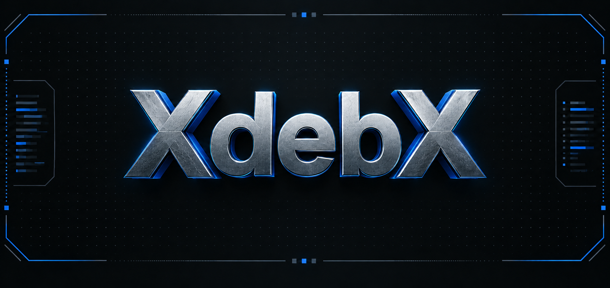

<p align="center">
  
</p>

<h1 align="center">XdebX</h1>

<p align="center">
  用一个中英双语终端界面，配置你的 Linux 系统环境。
</p>

<p align="center">
  
  
  
  
</p>

<p align="center">
  <a href="README.md">English</a> · <strong>简体中文</strong>
  <br>
  <a href="#快速开始">快速开始</a> · <a href="#功能特性">功能特性</a> · <a href="#文档导航">文档导航</a>
</p>

---

XdebX 将软件安装、Shell 配置和安装恢复整合到一个有边框的 TUI 中。选择安装清单、查看实时日志，并在保留已有配置的前提下重试未完成的项目。

## 功能特性

- **三个清晰入口。** Fast Install、Install List、Settings，右侧保留可滚动的安装日志。
- **中英双语。** 文案使用 JSON 管理，自动识别桌面环境并调整软件列表。
- **安装可以恢复。** 失败、中断和待补齐项目仍可选择；重试清理已记录的残留，保留可用组件和已有用户配置。
- **多级安装回退。** 优先使用系统 APT 或官方发布包，再尝试兼容的固定版本包和支持的源码构建；单项失败不影响独立项目。
- **适应不同网络。** Raw / CN 下载模式、任务级镜像回退，以及四个经过固定提交和文件哈希验证的 Gitee 插件镜像。
- **精致终端体验。** 银色与冷蓝配色、3D 字符动画、彩色日志和可选音乐；`--lite` 提供纯净界面。
- **精简默认缓存。** 启用的小型资产按单文件 5 MiB 上限保留，大包按需下载；缓存并非完整离线依赖仓库。

## 支持系统

| 发行版 | 版本 |
| --- | --- |
| Ubuntu | 20.04 · 22.04 · 24.04 |
| Debian | 12 · 13 |

**仅支持 AMD64 / x86_64。** 需要 Python 3.8+ 和 `curses`，TUI 无需安装第三方 Python 库。检测到桌面环境时展示桌面应用；具体软件的可用性取决于目标系统。

## 快速开始

### 从源码启动

```sh
git clone --depth 1 --single-branch --branch main \
  https://github.com/XLYing23333/XdebX.git
cd XdebX
./run_xdebx.sh
```

`main` 包含五个支持系统共用的源码。上述浅克隆只获取该分支的最新历史。正式版本使用 `v0.1.0` 这样的 tag；对应 tag 发布后，将 `--branch main` 替换为 `--branch v0.1.0` 即可下载固定版本。

建议使用普通用户启动，需要管理员权限时由 XdebX 请求 `sudo` 验证。直接以 root 运行时，必须明确指定目标用户：

```sh
./run_xdebx.sh --user YOUR_USERNAME
```

源码仓库不包含安装包、字体二进制和音乐。项目构建出的程序发行包附带四个配置指定的 Maple Mono NF 字体；源码用户的可选资源准备见[缓存与资源](#缓存与资源)。

### 选择界面与下载模式

```sh
./run_xdebx.sh --language EN --mirror Raw
./run_xdebx.sh --language CN --mirror CN
./run_xdebx.sh --lite
```

默认英语、Raw 下载源、音乐开启。仅在存在图形会话、音频文件和可用播放器时尝试播放音乐。

## TUI 操作

| 菜单 | 功能 |
| --- | --- |
| **Fast Install** | 预选配置中的 25 项清单，按系统和桌面环境过滤；执行前可以检查和调整。 |
| **Install List** | 搜索、多选和安装软件，访问配置操作、备份与安装历史。 |
| **Settings** | 修改语言、镜像与音乐偏好，清理下载缓存或删除 XdebX 状态。 |

完整安装的项目不能重复勾选；失败、中断和待补齐项目可以重新选择。**DeleteXdebX 位于 Settings，需要两级确认**，仅清理工具设置、日志和下载缓存，保留已安装软件及配置备份。

| 按键 | 操作 |
| --- | --- |
| `↑` / `↓`、`j` / `k` | 移动 |
| `Space`、`Enter` | 选择；打开或确认操作 |
| `/` | 搜索软件列表 |
| `Tab`、`PgUp` / `PgDn` | 切换日志面板；滚动日志 |
| `X` | 请求安全停止，留在当前界面 |
| `Esc`、`Q` | 返回；退出 |
| `C`、`B`、`H` | 安装列表中：应用配置、查看备份、查看历史 |
| `R` | 刷新；历史页面中重试项目 |

`[OK]` 表示已安装，`[~]` 表示需要处理，`[x]` 表示已选择。日志与项目数量进度条展示每项结果。退出时会等待正在执行的软件包事务安全结束，不强行终止 `dpkg`。

## 命令行用法

```sh
# 检查环境与可用软件
./run_xdebx.sh --doctor
./run_xdebx.sh --list --desktop no

# 先查看安装计划，再执行
./run_xdebx.sh --dry-run --fast
./run_xdebx.sh --install vim9 nodejs22-nvm --yes

# 重新应用配置并备份；软件必须已存在
./run_xdebx.sh --configure vim9 --yes

# 恢复一份配置备份记录
./run_xdebx.sh --restore /path/to/record.json
```

完整选项见 `--help`。显式配置操作可能重新应用模板，安装重试则保留已有配置。恢复操作遇到用户修改会拒绝覆盖；指定 `--force` 时，会先保留修改后的文件。

## 软件目录

| 分类 | 示例 |
| --- | --- |
| 终端工具 | Git、curl、wget、btop、htop、fastfetch、gdu、lsd |
| Shell 与编辑器 | Zsh + Oh My Zsh、Vim 9 + 插件、Tmux + tmuxp |
| 运行时 | Node.js 22 + NVM、uv、Miniconda、JDK 21、Go、TeX Live |
| 服务 | Docker、MySQL、Redis |
| 编程助手 | Claude Code + DeepSeek、OpenCode、OpenClaw |
| 桌面应用 | Ghostty、VS Code、Chrome、gedit、VLC、Snipaste |

具体版本和系统限制记录在安装包清单中。配置会使用项目提供的 Zsh、Vim、Tmux 和 DeepSeek 模板，需要凭据时请自行填写。新装 Go 使用 `~/Software/go`，已有 `/opt/go` 仍可被检测。

## 镜像与安装恢复

```text
APT / 官方发布包 → 兼容的固定版本包 → 支持的源码构建 → 记录失败
```

CN 镜像只作用于当前任务，不改写全局 APT 或 npm 设置。CN 下载失败时，可以尝试对应官方来源。Git 使用限时浅克隆、HTTP/1.1 和固定提交；CN 优先使用已验证的 **Oh My Zsh、NERDTree、zsh-autosuggestions、zsh-syntax-highlighting** Gitee 镜像。Git 来源不可用时，回退到通过哈希校验的快照。

恢复只清理已记录的临时残留。不完整的托管组件会先备份，归属不明的目录保留待检查。设置、状态、缓存和备份遵守 XDG 目录。

## 缓存与资源

在源码仓库中补充默认小包缓存，不安装软件：

```sh
python3 tools/cache_packages.py
# 显式获取完整缓存及配套源码
python3 tools/cache_packages.py --full
```

可以通过 `./run_xdebx.sh --import-cache /path/to/cache.tar.gz` 导入可识别的缓存归档。大型应用及缺失依赖仍可能需要联网，详情见[缓存说明](data/pkgs/README.md)。

字体位于 `data/fonts/`。可选音频使用 `data/music/電脳眠眠猫short.mp3`，调用已有的 `ffplay`、`mpv` 或 `mpg123`；资源缺失或播放失败不会阻止启动。README 头图保存在 [`assets/`](assets/)。

### 音乐署名

可选背景音乐：**《電脳眠眠猫 ins.》（电脑眠眠猫，伴奏版）**。作曲、作词、混音：**なみぐる（namigroove）**。原曲另有桃寝ちのい演唱版与可不（KAFU）演唱版；`ins.` 指伴奏版。

- [原作者发布的伴奏与使用条件（piapro）](https://piapro.jp/t/21O9)
- [原作完整制作名单](https://nekomo.info/works/myenmao/)

本地播放文件为 `data/music/電脳眠眠猫short.mp3`。音频不随源码仓库或默认发行包分发；署名不改变原作者的使用条件，原作者伴奏页面标注仅限非营利用途。

### 只下载需要的缓存

程序包支持全部五个系统。缓存通过独立的 `cache-YYYY.MM.DD.N` Release 提供，无需切换源码分支。

| 下载文件 | 用途 |
| --- | --- |
| `xdebx-v<VERSION>-linux-amd64.tar.gz` | 程序与配置指定的字体 |
| `xdebx-cache-<SNAPSHOT>-common.tar.gz` | 可选的通用小包缓存 |
| `xdebx-cache-<SNAPSHOT>-<TARGET>.tar.gz` | 仅对应系统的可选缓存 |

`<SNAPSHOT>` 为 `cache-` 后的日期与序号，`<TARGET>` 为 `ubuntu20`、`ubuntu22`、`ubuntu24`、`debian12` 或 `debian13`。例如 Ubuntu 24.04 用户只需导入**同一快照**中的 common 和 ubuntu24 缓存附件（若有），无需下载其他系统的缓存。未生成的分组表示没有对应的内置资源。完整缓存按需提供，未解决的依赖仍需要联网。

缓存 Release 同时提供 `resources.json`、校验文件，以及必要的第三方许可证和对应源码附件。缓存快照与程序版本 tag 分开发布，缓存 Release 不设为 Latest，已发布附件不可替换为不同内容。

## 开发与验证

在源码仓库中运行检查：

```sh
python3 -m unittest discover -s tests -v
# 在本机一次性容器中进行真实安装与恢复检查
python3 tools/test_recovery_matrix.py
```

将本地程序包和缓存发行包构建到空目录：

```sh
python3 tools/build_release.py \
  --repository XLYing23333/XdebX \
  --output dist/local
```

欢迎提交改进。反馈问题时请提供发行版、桌面环境和相关日志；修改安装或恢复行为时，请补充有针对性的回归验证。

## 文档导航

[缓存说明](data/pkgs/README.md)：小包缓存策略与按需下载。
